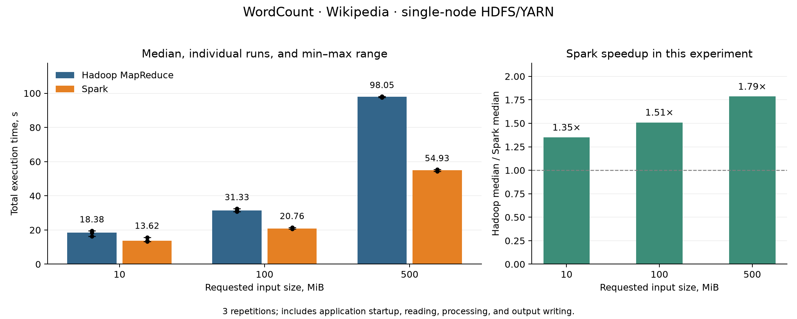
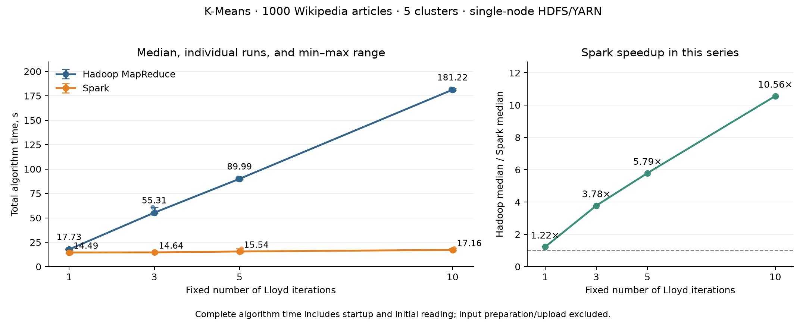

# Hadoop MapReduce vs Apache Spark

A Python benchmark project comparing real Hadoop Streaming and PySpark applications
on a single-node HDFS/YARN cluster. Two workloads explore how input size and
iteration count affect execution time: **WordCount** and **Lloyd K-Means**.

Built as a university project for Distributed Systems and Algorithms at Kaunas
University of Technology. The experiments adapt the method of Ketu, Mishra, and
Agarwal (2020); they use a different corpus and do not reproduce the paper's exact
numerical results.

## What the project demonstrates

- Hadoop Streaming mappers/reducers and PySpark RDD transformations.
- Shared Unicode tokenization and deterministic K-Means rules across engines.
- Sparse TF-IDF preparation, seeded centers, and persisted Spark input vectors.
- HDFS/YARN setup, application submission, and comparable worker resource requests.
- Repeated benchmarks, complete output validation, and automated charts/reports.

## Recorded results

Each condition was repeated three times. Times below are medians of complete
application runs, including startup; the ratio is Hadoop time divided by Spark time.

| Workload | Configuration | Hadoop | Spark | Ratio |
|---|---|---:|---:|---:|
| WordCount | 10 MiB | 18.380 s | 13.618 s | 1.35× |
| WordCount | 100 MiB | 31.332 s | 20.759 s | 1.51× |
| WordCount | 500 MiB | 98.047 s | 54.926 s | 1.79× |
| K-Means | 1 iteration | 17.729 s | 14.494 s | 1.22× |
| K-Means | 3 iterations | 55.308 s | 14.639 s | 3.78× |
| K-Means | 5 iterations | 89.993 s | 15.539 s | 5.79× |
| K-Means | 10 iterations | 181.219 s | 17.158 s | 10.56× |





WordCount outputs match exactly. K-Means cluster counts match exactly and center
coordinates match within floating-point tolerances. K-Means uses 1,000 articles,
1,000 TF-IDF features, and five clusters.

These results describe one machine and configuration. They do not establish
multi-node scalability or universal speedups. Startup costs, serialization,
shuffle, and different aggregation strategies contribute to the observed timings.
See the [WordCount report](reports/wordcount.md), [K-Means report](reports/kmeans.md),
and [published measurement files](benchmarks/README.md) for methodology and limits.

## Architecture

```text
Wikipedia text ── shared tokenizer ── Hadoop Streaming / PySpark WordCount
                                  └─ complete output comparison

Wikipedia articles ── TF-IDF vectors + seeded initial centers
                   ├─ Hadoop: one Streaming job per iteration
                   └─ Spark: one application with persisted vectors
                       └─ per-iteration center and count validation

Repeated runs ── measurements ── statistical summaries ── charts and reports
```

## Getting started

The recorded environment uses Ubuntu, Python 3.12, Java 17, Hadoop 3.5.0,
and Spark 3.5.7. Install Java 17, `curl`, and Python's venv support first.
The configured YARN worker allocation is 8 GiB; leave additional RAM for the OS,
control services, and application clients (the measured machine has about 24 GiB).

```bash
python3 -m venv .venv
source .venv/bin/activate
python -m pip install -r requirements.txt -r requirements-report.txt
python -m unittest discover -s tests -v
```

Run a small end-to-end check before preparing the full dataset:

```bash
python scripts/cluster.py setup
python scripts/cluster.py smoke
python scripts/cluster.py stop
```

`setup` downloads Hadoop, checks the archive, configures HDFS/YARN, and starts
services. `smoke` runs both WordCount engines on a built-in fixture and validates
their results. It needs neither the full Wikipedia corpus nor TF-IDF preparation.
All downloaded software and cluster state stay in the ignored `.runtime/` directory.

## Full experiments

Input datasets are excluded from Git. Prepare the following files first:

| Input | Preparation |
|---|---|
| `data/wikipedia.txt` | UTF-8 text corpus of at least 500 MiB for WordCount |
| `data/wikipedia_articles.jsonl` | Article downloader shown below |
| `data/kmeans/vectors.jsonl` | TF-IDF preparation shown below |
| `data/kmeans/initial_centers.json` | Seeded initialization shown below |

```bash
python -m pip install -r requirements-download.txt -r requirements-prepare.txt
python scripts/download_wikipedia.py --articles 1000
python scripts/prepare_vectors.py
python scripts/initialize_centers.py
```

The downloader writes article JSONL, not `wikipedia.txt`. To build a new WordCount
corpus from the same source, download a larger article collection to a separate file
and export the `text` fields as UTF-8 plain text. Check that the resulting text is at
least 500 MiB. A new corpus produces new measurements; the original WordCount input
is not distributed with this repository.

With all inputs ready:

```bash
python main.py --plan
python main.py
python scripts/cluster.py stop
```

The runner executes 18 WordCount applications and 24 K-Means applications,
validates results, and generates reports in a new `results/full-<ID>/reports/`
directory. `--plan` only prints the schedule. Use `--output results/my-series`
to select a new output directory. The cluster remains running until stopped.

See [detailed reproduction instructions](docs/reproduction.md) for individual
commands, resource configuration, timing definitions, and troubleshooting.
Optional dependencies are separated by purpose in `requirements-*.txt`.

## Repository layout

```text
common/        Shared tokenization and K-Means numerical rules
config/        Resource profiles and TF-IDF settings
hadoop/        Streaming mappers and reducers
spark/         PySpark applications
scripts/       Cluster lifecycle, input preparation, runners, and analysis
tests/         Unit tests for algorithms, protocols, runners, and scheduling
benchmarks/    Published historical measurements and summaries
reports/       Recorded charts, reports, and presentation
docs/          Detailed reproduction guide and interview notes
main.py        Complete experiment runner
```

`data/`, `results/`, `.runtime/`, and `.venv/` are local working directories excluded
from Git. Reports and the small published benchmark tables are included.

For a walkthrough of implementation choices and tradeoffs, see the
[interview notes](docs/interview-notes.md). The [final report](reports/final_report.md)
and [presentation](reports/presentation.pdf) document the original academic work.

## Reference

Ketu, Mishra, and Agarwal (2020), *Performance Analysis of Distributed Computing
Frameworks for Big Data Analytics: Hadoop Vs Spark*. DOI: `10.13053/CyS-24-2-3401`.
The paper's local PDF is excluded from Git; use the DOI to locate the publication.
