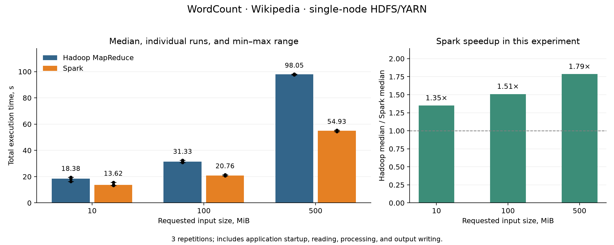
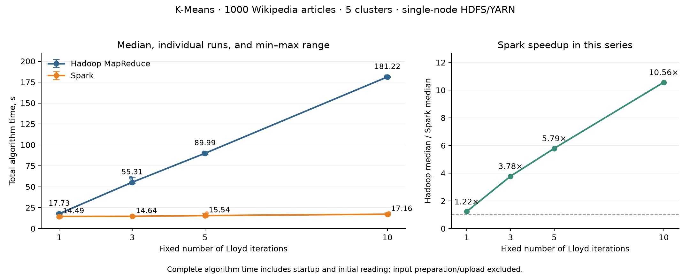

# Performance Analysis of Hadoop MapReduce and Apache Spark

## Scientific paper analysis and adapted experimental reproduction

Course: T120M337 Distributed Systems and Algorithms

Student: Alikhan Sagymbekov

Group: IFMU-5

Supervisor: Assoc. Prof. Germanas Budnikas

Experiment date: 20 October 2026

## Abstract

This work analyzes Ketu, Mishra, and Agarwal (2020) and adapts two of its experiments
using real Hadoop Streaming and PySpark on a single-node HDFS/YARN environment.
WordCount was evaluated on 10, 100, and 500 MiB of English Wikipedia text.
Lloyd K-Means was evaluated on 1000 Wikipedia article vectors with 1, 3, 5, and
10 fixed iterations. Every condition was repeated three times. Complete
WordCount outputs and all K-Means iteration centers and counts were validated.
Spark had lower median time in both series. The observed Hadoop/Spark ratios
were 1.35–1.79 for WordCount and 1.22–10.56 for K-Means. These results describe
this hardware, workload, and implementation; they are not universal speedup claims.

## 1. Source paper and research scope

Source: Shwet Ketu, Pramod Kumar Mishra, and Sonali Agarwal. Performance Analysis
of Distributed Computing Frameworks for Big Data Analytics: Hadoop Vs Spark.
Computación y Sistemas, 24(2), 669–686, 2020. DOI: 10.13053/CyS-24-2-3401 [1].

The paper combines a qualitative comparison of Hadoop MapReduce and Spark with
experimental evaluation of WordCount, logistic regression, and distributed K-Means.
The present project selects WordCount (§5.1) and iterative K-Means (§5.3).
It reproduces the experimental ideas, not the authors' exact setup or numerical results.
No logistic regression experiment is claimed.

The questions below organize this reproduction; they are not quotations of formally
numbered research questions from the paper:

- RQ1: How do the frameworks execute the same data-processing task?
- RQ2: How does WordCount time change with input size?
- RQ3: How does K-Means time change with iteration count?
- RQ4: Do both implementations produce equivalent numerical results?
- RQ5: Which configuration and implementation differences limit the conclusions?

## 2. Original experiments versus this reproduction

The paper's WordCount Figures 8–9 compare Wikilinks and Wikilanguage at sizes
labelled 500 MB through 40 GB. Its surrounding prose lists inconsistent size
ranges, so figure labels are the reference here. Iterative K-Means Figures 14–15
use four corpora of 5 GB with one to three iterations; Figure 16 uses a 40 GB
corpus with 1, 2, 3, 5, 7, and 9 iterations.

This reproduction uses 10, 100, and 500 MiB of Wikipedia for WordCount and a
1000-document Wikipedia subset for K-Means. Our K-Means features, cluster count,
initialization seed, and timing boundaries are explicitly recorded. The paper does
not provide enough of these details to reconstruct its text-clustering pipeline
exactly. The text refers to hardware in Table 14, but that table contains framework
key features rather than a complete hardware specification.

Figure 8 reports Hadoop/Spark times of 102/54 s at 500 MB and 1762/1630 s at 40 GB.
Thus Spark's relative advantage narrows across those endpoints. Our WordCount
advantage grows with size. Both studies rank Spark faster on the tested inputs,
but the scaling trends and absolute times are not the same. MB/GB labels in the
paper must not be silently treated as the precise MiB units used here.

Figure 16 labels the first-iteration on-disk/in-memory times as 1721/1821 s and
nine-iteration times as 15489/1981 s. The figure therefore illustrates an increasing
iterative advantage, with an initially slower in-memory case. Our one-iteration
Spark run is already faster. These are qualitative comparisons, not matched benchmarks.

## 3. Implementation and architecture

The implementation uses Python application logic with the actual engines.
Hadoop Streaming launches Python mapper/reducer subprocesses and performs
partitioning, shuffle, sorting, and task scheduling through Hadoop MapReduce.
PySpark expresses processing through RDD transformations and actions.

HDFS provides common storage. YARN allocates resources for both frameworks.
NameNode, DataNode, ResourceManager, and NodeManager run as separate JVM
processes on one computer. This is pseudo-distributed operation, not a multi-node cluster.

The supplied example presentation was used only as a structural guide: research
questions, fundamentals, study design, results, own implementation, and conclusions.
Its GraphQL subject, author details, and faculty logo were not copied into this work.

## 4. Hardware, software, and resources

CPU: Intel Core i5-10300H at 2.50 GHz. Linux reports approximately 23.3 GiB of usable
RAM (MemTotal: 24436484 KiB; approximately 24 GB installed). Python 3.12.3,
Java 17.0.20.1, Hadoop 3.5.0, Spark 3.5.7, and scikit-learn 1.9.1 were used.
Detailed version strings and Linux platform information are preserved in manifests.

The YARN worker advertises 4 vcores and 8192 MiB. Applications are run sequentially.
The experimental worker budget is up to 2 vcores and 2048 MiB: Hadoop allows
up to two map or two reduce tasks, each requesting 1024 MiB with a 512 MiB Java heap.
Spark requests one two-core executor with a 1024 MiB heap and 1024 MiB overhead.
ApplicationMasters request 1024 MiB. Spark's client-mode driver runs outside YARN
with a 1024 MiB heap. Speculative execution and Spark dynamic allocation are disabled.

These are comparable worker resource requests, not equal total application memory
or strict CPU isolation. Hadoop reducers start only after all maps finish; this
experimental restriction can affect performance. Both pipelines use two output
aggregation partitions and a 64 MiB input-split limit. Actual reading partitions
can differ. Configurations are in config/wordcount.json and config/kmeans.json;
XML and code snapshots are recorded with runs.

## 5. Experiment 1: WordCount

The input consists of prefixes of the existing English Wikipedia corpus. Each
prefix ends on a complete line; exact bytes and hashes are recorded. Both systems
use the same lowercase Unicode-letter/digit tokenizer, with punctuation and
underscores separating tokens.

Hadoop emits word/count pairs, optionally combines local counts, and reduces by
word. Spark uses flatMap, map, and reduceByKey. Both save complete dictionaries
to HDFS. No top-ten operation substitutes for a full result and no persistence is used.

Each size was measured three times per engine: 18 applications. Engine order
alternated. Timing includes application startup, reading, counting, shuffle, and
writing. Preparing and uploading inputs, downloading outputs, and correctness
checks are excluded. No separate warm-up or OS cache reset was performed.

| Requested input, MiB | Hadoop median, s | Spark median, s | Hadoop/Spark |
|---:|---:|---:|---:|
| 10 | 18.380 | 13.618 | 1.350× |
| 100 | 31.332 | 20.759 | 1.509× |
| 500 | 98.047 | 54.926 | 1.785× |



Full output dictionaries matched across all runs at each size. At 500 MiB, each
result contained 969289 unique tokens and 84735062 token occurrences.
Observed ranges, individual measurements, means, and standard deviations are
available in the experiment CSV files and the detailed WordCount report.

## 6. Document preparation for K-Means

A separate JSONL download preserves one complete article per record, including
its original ID, title, text, and URL. The 1000 articles are a prefix in source order,
not a random or representative sample. The dataset snapshot is 20231101.en;
its resolved repository commit and source checksum are recorded.

Only text is vectorized. TfidfVectorizer uses the shared tokenizer, English stop
words, min_df=2, max_df=0.9, at most 1000 features, sublinear term frequency,
smoothed IDF, and L2 row normalization. Each feature index has the same meaning
for every document and for both engines. IDs and titles are not numerical features.

The transform uses TF=1+ln(count), IDF=ln((1+N)/(1+df))+1, followed by division
by the vector's Euclidean norm. All 1000 documents produced nonzero 1000-dimensional
vectors, containing 243248 stored values. Sparse JSONL stores only nonzero positions.
The vocabulary, IDF weights, document links, checksums, and preprocessing time are saved.
Preparation ran locally in about 2.7 seconds and is excluded from engine timings.

## 7. Experiment 2: iterative Lloyd K-Means

Five distinct document vectors are sampled with seed 42 as initial centers.
Both engines read the same vectors and exact center file. Squared Euclidean
distance determines assignments. Exact ties select the lowest center index.
Each new center is the arithmetic mean; centers are not renormalized.
An empty cluster retains its previous center. Early stopping is disabled.

Hadoop submits a new Streaming job per iteration. The mapper assigns documents,
Hadoop shuffles them by cluster, and the reducer computes means. The launcher
downloads updates, verifies document counts, merges empty clusters, and passes
the new centers to the next job. This implementation has no K-Means combiner.

Spark runs one application, materializes a MEMORY_AND_DISK persisted RDD,
broadcasts centers, aggregates partition-local sums/counts, reduces by cluster,
and collects only the small center aggregates. Initial loading and persistence
are included; persistence may spill to disk rather than being purely in memory.

There are 1, 3, 5, and 10 fixed iterations, with three repetitions per engine:
24 applications, including 57 Hadoop iteration jobs and 12 Spark applications.
Hadoop ran first in repetitions 1 and 3; Spark ran first in repetition 2.
Order alternates but is not perfectly balanced.

Timing includes startup and initial reading. Hadoop includes intermediate center
downloads, merging, and snapshots. Spark includes shutdown and final-center
writing/download/validation. Input preprocessing, validation/upload, and source
staging are excluded. Final local objective scans are outside the engine timer.
Internal Spark iteration timers are diagnostics, not the comparison metric.

| Fixed iterations | Hadoop median, s | Spark median, s | Hadoop/Spark |
|---:|---:|---:|---:|
| 1 | 17.729 | 14.494 | 1.223× |
| 3 | 55.308 | 14.639 | 3.778× |
| 5 | 89.993 | 15.539 | 5.791× |
| 10 | 181.219 | 17.158 | 10.562× |



Every iteration's full center matrix and counts match between engines and across
repetitions. Counts match exactly; coordinate checks use relative tolerance 1e-9
and absolute tolerance 1e-10. The largest observed difference is about 7e-17.
The objective falls from 1346.435812 initially to 722.709028 after ten iterations.
This is a consistency check, not an external semantic-quality evaluation.

## 8. Discussion and threats to validity

Spark had lower median complete time in both series. K-Means shows a much
stronger relative advantage as iterations increase. Reusing an application and
persisted vectors avoids repeated Hadoop job launches and repeated input processing.
On this small sample, startup and coordination form a substantial part of total time.

The experiment does not isolate caching as a cause. Spark uses partition-local
aggregation whereas Hadoop K-Means shuffles complete sparse vectors without a
combiner. Serialization, Python subprocesses, shuffle, task partitions, center
transfers, and scheduling differ. A separate ablation study would be needed to
quantify each contribution.

Only one machine, one corpus prefix, and three repetitions were tested. OS caches
were not reset and execution order was not randomized. Resource requests are
not identical total resource usage. Peak RAM, CPU, disk traffic, and multi-node
scalability were not measured. The small K-Means sample does not reproduce the
paper's multi-gigabyte scale, and no class labels assess clustering quality.
Observed min–max ranges are not confidence intervals.

Some broad claims in the 2020 paper should not be repeated as universal rules.
Our Hadoop logic is Python through Streaming, so Hadoop is not Java-only from an
application developer's perspective. Spark can spill to disk and does not keep
all computations exclusively in RAM. Security, cost, and failure tolerance were
not empirically compared in this project.

## 9. Reproducibility and project deliverables

The completed source series are:

- WordCount: results/wordcount-20261020-214202-2d74ef/
- K-Means: results/kmeans-series-0x5T5dCJ/

They retain per-run logs, metrics, manifests, input/initialization hashes,
configuration snapshots, and validation artifacts. Summary CSV files contain
medians, means, ranges, and sample standard deviations. The README documents
installation, smoke checks, submission, and analysis commands. The code has 34
passing checks; actual engine experiments ran in the user's regular terminal.

Regenerate figures without rerunning the experiments:

```bash
python scripts/analyze_wordcount.py results/wordcount-20261020-214202-2d74ef
python scripts/analyze_kmeans.py results/kmeans-series-0x5T5dCJ
```

## 10. Conclusions

Two experimental ideas from the paper were implemented using real Hadoop and
Spark rather than a custom engine simulation. Identical results were verified.
WordCount median speedups range from 1.35 to 1.79; K-Means median speedups range
from 1.22 to 10.56 under the recorded conditions.

The iterative result supports the practical benefit of reusing an application and
persisted inputs, while the measurements do not attribute all differences solely
to memory caching. Future work should add larger, representative corpora, more
repetitions, Hadoop local aggregation, controlled ablations, resource measurements,
and a multi-node environment.

## References

[1] Ketu, S., Mishra, P. K., and Agarwal, S. (2020). Performance Analysis of Distributed
Computing Frameworks for Big Data Analytics: Hadoop Vs Spark. Computación y Sistemas,
24(2), 669–686. https://doi.org/10.13053/CyS-24-2-3401

[2] Apache Hadoop 3.5.0: Single Node Setup and Hadoop Streaming documentation.
https://hadoop.apache.org/docs/r3.5.0/

[3] Apache Spark 3.5.7: configuration, RDD programming, and YARN documentation.
https://spark.apache.org/docs/3.5.7/

[4] scikit-learn: TfidfVectorizer documentation.
https://scikit-learn.org/stable/modules/generated/sklearn.feature_extraction.text.TfidfVectorizer.html

[5] Wikimedia Wikipedia dataset, 20231101.en; resolved source revision is recorded
in the download metadata. https://huggingface.co/datasets/wikimedia/wikipedia

[6] Denys Krysanov, Migrating to GraphQL: A Practical Assessment, course presentation
provided by the user, 12 November 2025. Used only as a presentation structure example.
