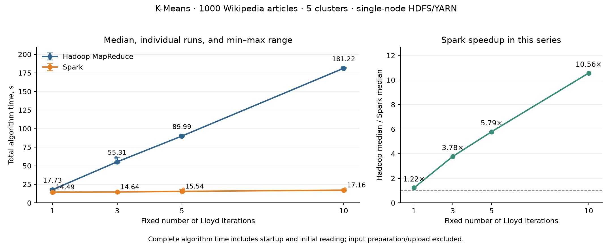

# Experiment 2: iterative K-Means — Hadoop MapReduce vs Spark

Source series: [kmeans-series-0x5T5dCJ](../benchmarks/kmeans/).

## Method

This adapts the iterative K-Means experiment in Section 5.3 of Ketu, Mishra, and Agarwal (2020), DOI: 10.13053/CyS-24-2-3401. It does not reproduce the original corpus sizes or the paper's exact feature pipeline.

The workload contains 1000 English Wikipedia articles, 1000-dimensional L2-normalized TF-IDF vectors, and 5 clusters. The sample is a prefix in source order, not a random or representative selection. Article IDs link vectors back to source documents.

Both implementations use identical input vectors and initial centers selected from distinct document vectors with seed 42. They use squared Euclidean distance, arithmetic means without renormalization, lowest-index exact-tie resolution, and preservation of previous centers for empty clusters. There is no early stopping.

Fixed iteration counts: [1, 3, 5, 10]; repetitions per condition: 3; applications: 24. Within each repetition, both engines run for every iteration count. Hadoop runs first in repetitions 1 and 3; Spark runs first in repetition 2. This alternates order but is not perfectly balanced.

## Execution and resources

Both engines run on the same single-node HDFS/YARN cluster. The shared worker budget requests two vcores and 2048 MiB: Hadoop allows up to two tasks with 1024 MiB containers and 512 MiB heaps; Spark uses one two-core executor with 1024 MiB heap plus 1024 MiB overhead. ApplicationMasters request 1024 MiB. The Spark client-mode driver runs separately with a 1024 MiB heap. These are comparable worker requests, not identical total memory usage or physical CPU isolation.

Hadoop launches a separate Streaming job for every iteration. It reads vectors from HDFS, shuffles assignments, reduces groups, then downloads and merges the new centers before the next job. Reducers start after all maps complete.

Spark launches one application per run, reads and validates the vectors once, and materializes a MEMORY_AND_DISK persisted RDD. Each iteration broadcasts centers, aggregates local sums, reduces by cluster, and updates centers. Persistence may spill to disk. The initial read/persistence is included in timing.

## Timing definition

The reported total includes application/job startup, reading, processing, and output. Hadoop includes intermediate center downloads and merging; Spark includes shutdown and downloading the final center state. Local input validation, TF-IDF preparation, HDFS input upload, and code staging are excluded for both. Local final-objective scans are correctness checks outside the timer. Internal Spark iteration timers are not used for this comparison.

## Results

| Iterations | Hadoop median [min–max], s | Spark median [min–max], s | Hadoop/Spark |
|---:|---:|---:|---:|
| 1 | 17.729 [17.724–18.103] | 14.494 [14.082–17.110] | 1.223× |
| 3 | 55.308 [54.502–60.771] | 14.639 [14.573–14.726] | 3.778× |
| 5 | 89.993 [89.151–90.907] | 15.539 [15.195–18.341] | 5.791× |
| 10 | 181.219 [180.636–182.341] | 17.158 [16.539–18.862] | 10.562× |

Error bars show observed min–max ranges, not confidence intervals. Speedup is the ratio of medians. Individual measurements and sample standard deviations are saved in the CSV files.

## Correctness

Every application completed successfully. Full per-iteration center matrices and cluster counts match between engines and across repetitions. Counts match exactly; coordinates use relative tolerance 1e-9 and absolute tolerance 1e-10. The largest observed absolute coordinate difference is 6.94e-17.

| Iterations | Final objective (sum of squared nearest-center distances) |
|---:|---:|
| 1 | 765.686326 |
| 3 | 735.748955 |
| 5 | 728.355283 |
| 10 | 722.709028 |

## Interpretation and limitations

Spark had lower median time at every tested iteration count. The ratio of Hadoop to Spark median time increased from 1.22 at 1 iteration(s) to 10.56 at 10 iterations.

Hadoop time grows roughly with the number of jobs, while Spark reuses one application and its persisted vectors. On this small workload, startup and coordination costs are substantial, making Spark's total time comparatively flat. This is consistent with the iterative-performance trend discussed in the paper.

The observed difference cannot be attributed solely to caching: Spark also uses partition-local aggregation, while the current Hadoop implementation has no combiner and shuffles full sparse vectors. Python process startup, serialization, task partitioning, reducer scheduling, and center transfers also differ. No ablation study isolates these effects.

This 1000-document workload is small, not a demonstration of multi-node scalability or the paper's multi-gigabyte results. There are only three repetitions, OS caches were not reset, and workloads were not randomized. Actual peak RAM, CPU usage, disk traffic, and clustering quality against ground truth were not measured. The objective decreasing is an algorithm consistency check, not evidence of semantic clustering quality.

## Presentation summary

“I compared the same fixed-iteration Lloyd K-Means on identical TF-IDF vectors and initial centers using real Hadoop Streaming and PySpark on YARN. Each configuration was repeated three times, and all iteration centers and counts were verified. Spark was faster in this configuration, with its relative advantage increasing as more iterations reused the persisted input. The result includes application startup and initial loading and does not establish a universal speedup.”
