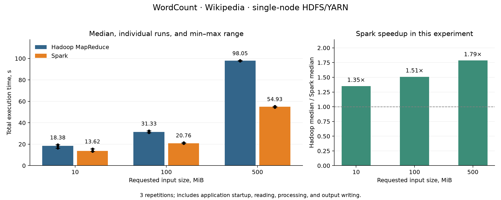

# Experiment 1: WordCount — Hadoop MapReduce vs Spark

Measurements: [wordcount-20261020-214202-2d74ef](../benchmarks/wordcount/measurements.csv).

## Method

Real Hadoop Streaming and PySpark applications ran sequentially on a single computer through YARN, reading identical input files from HDFS. This adapts Section 5.1 of Ketu, Mishra, and Agarwal (2020), DOI: 10.13053/CyS-24-2-3401. The corpus and input sizes differ from the original paper.

Hardware: Intel(R) Core(TM) i5-10300H CPU @ 2.50GHz; RAM: MemTotal:       24436484 kB. Python 3.12.3; Spark 3.5.7; Hadoop 3.5.0; Java 17.

Requested input sizes: [10, 100, 500] MiB; repetitions: 3; total jobs: 18. Prefixes end at complete lines. Exact byte counts and SHA256 hashes are recorded in manifest.json. Engine order alternated. There was no separate warm-up and the OS file cache was not cleared.

**The timer measures the complete application launch:** JVM startup, resource allocation, reading, counting, shuffle, and output writing. Input preparation, uploading inputs to HDFS, downloading outputs, and validation are excluded.

## Resource configuration

Requested worker budget: up to 2 vcores and 2048 MiB. Hadoop runs up to 2 map tasks or 2 reduce tasks concurrently. Each task requests one vcore and 1024 MiB with a 512 MiB Java heap. Reduce tasks start after all map tasks finish. Spark uses one executor with 2 cores, a 1024 MiB heap, and 1024 MiB overhead. Both engines use 2 output partitions. The ApplicationMaster requests 1024 MiB. Speculative execution is disabled.

These are comparable worker resource requests, not equal total application resource usage. The Spark driver runs outside YARN with a 1024 MiB heap. Control processes differ between engines. Delaying reducers affects Hadoop performance, and the number of input partitions can differ. YARN vcores do not pin processes to physical CPU cores.

## Results

| Input, MiB | Hadoop median [min–max], s | Spark median [min–max], s | Hadoop/Spark |
|---:|---:|---:|---:|
| 10 | 18.380 [16.282–19.480] | 13.618 [13.177–15.761] | 1.350× |
| 100 | 31.332 [30.790–32.476] | 20.759 [20.686–21.427] | 1.509× |
| 500 | 98.047 [97.501–98.084] | 54.926 [54.237–55.299] | 1.785× |

Speedup is the ratio of median times, not the mean of per-run ratios. Error bars show the observed min–max range, not a confidence interval. Black points show individual measurements.

## Correctness

During the experiment, complete word-count dictionaries were checked for equality across all runs at each input size. Both engines use the same tokenization: lowercase Unicode letters and digits. Additional consistency checks:

| Input, MiB | Unique words | Total occurrences |
|---:|---:|---:|
| 10 | 75,841 | 1,667,016 |
| 100 | 330,751 | 16,856,958 |
| 500 | 969,289 | 84,735,062 |

## Conclusions and presentation notes

Spark had a lower median time at every tested input size. The Hadoop/Spark median-time ratio ranged from 1.35 to 1.79. This is an adapted reproduction of the method rather than an exact reproduction of the paper's numerical results.

At 500 MiB, Hadoop took 98.047 s and Spark took 54.926 s. The time ratio was 1.79; the relative change in Spark execution time compared with Hadoop was -44.0%.

These findings apply to the recorded versions, hardware, corpus, Python implementations, and configuration. Three repetitions do not demonstrate universal superiority. Peak RAM, CPU usage, and disk I/O were not measured. The difference cannot be attributed solely to in-memory computation: persist/cache were not used, and Streaming, serialization, shuffle, and process startup costs differ.

## Related experiment

The completed [K-Means experiment](kmeans.md) compares fixed iteration counts using identical vectors and initial centers. Hadoop launches one job per iteration; Spark reuses persisted vectors.
